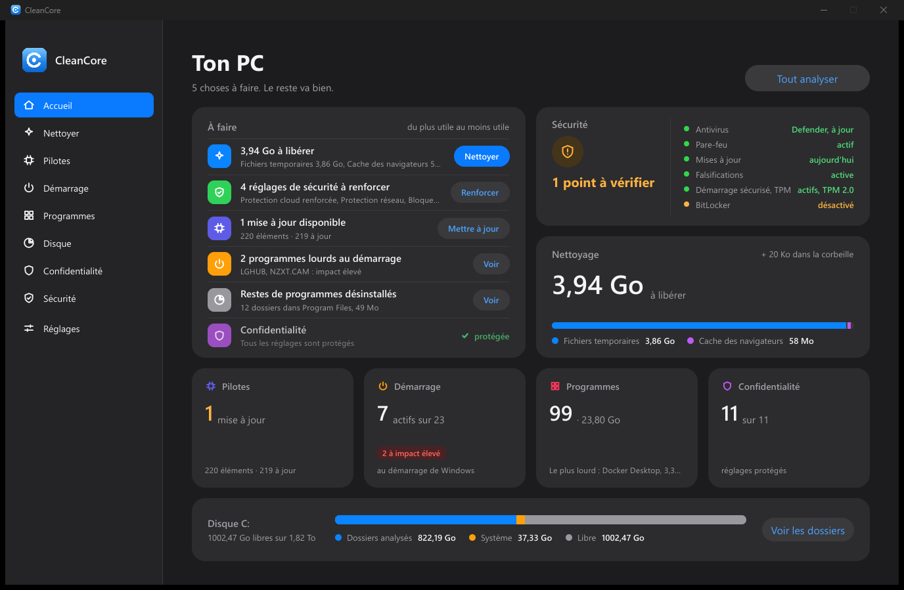

<div align="center">


# CleanCore

**Un seul logiciel pour entretenir ton PC Windows : nettoyage, pilotes, démarrage, programmes, disque, vie privée et sécurité.**<br>
Sans publicité, sans abonnement, sans compte.

[](https://github.com/LeKdeX/cleancore-releases/releases/latest)
[](https://github.com/LeKdeX/cleancore-releases/releases)


[-0071e3?style=for-the-badge)](https://github.com/LeKdeX/cleancore-releases/releases/latest/download/CleanCore.exe)
&nbsp;
[-25272b?style=for-the-badge)](https://github.com/LeKdeX/cleancore-releases/releases/latest/download/CleanCore-Setup.exe)



</div>

## Sept modules, une seule fenêtre

| Module | Ce qu'il fait |
|---|---|
| **Nettoyer** | Fichiers temporaires, caches, journaux, shaders, corbeille (avec un aperçu de ce qu'elle contient). Tu vois ce qui sera supprimé avant de confirmer. |
| **Pilotes** | Inventaire de tes pilotes, mises à jour via Windows Update et NVIDIA, sauvegarde avant installation, historique. Si une mise à jour échoue, la raison est expliquée. |
| **Démarrage** | Les programmes qui se lancent avec Windows (registre, dossiers Démarrage, applications du Store), avec leur impact sur le démarrage (faible, moyen, élevé). Rien n'est supprimé, tu peux tout réactiver. |
| **Programmes** | Les programmes installés, triés par taille, désinstallation en lot : chaque désinstalleur attend la fin du précédent, jeux Steam compris. |
| **Disque** | Où part l'espace, dossier par dossier. Les éléments vont à la corbeille ; les restes de programmes désinstallés peuvent être supprimés, et chaque refus dit quoi faire à la place. |
| **Confidentialité** | 11 réglages de vie privée de Windows, avec retour exact à l'état d'origine. |
| **Sécurité** | L'état de ta protection (antivirus, pare-feu, mises à jour, TPM, BitLocker), une analyse avec Windows Defender et son avancement, et 10 réglages pour renforcer Windows, chacun expliqué au survol. |

L'**Accueil** dit d'abord ce qu'il reste à faire, du plus utile au moins utile, puis résume chaque module. Chaque ligne et chaque tuile ouvre la bonne page.

## Pourquoi CleanCore

- **Ultra léger** : un seul fichier d'environ 10 Mo, 0 % de CPU au repos.
- **Prudent** : une confirmation avant d'agir, des sauvegardes avant de modifier, des éléments système protégés, et la corbeille plutôt que la suppression définitive.
- **Sobre** : aucune télémétrie, aucun service en tâche de fond. Seule connexion réseau hors pilotes : la recherche d'une nouvelle version au démarrage, désactivable.
- **Cohérent** : même fenêtre, mêmes boutons, même thème (clair, sombre ou automatique selon Windows, au choix dans les Réglages) pour les sept modules.

## Téléchargement

| Fichier | Pour qui |
|---|---|
| [**CleanCore.exe**](https://github.com/LeKdeX/cleancore-releases/releases/latest/download/CleanCore.exe) | **Version portable.** Tu double-cliques, c'est lancé. |
| [**CleanCore-Setup.exe**](https://github.com/LeKdeX/cleancore-releases/releases/latest/download/CleanCore-Setup.exe) | **Installeur.** Raccourci dans le menu Démarrer et désinstallation depuis Windows. |

Toutes les versions sont dans les [Releases](https://github.com/LeKdeX/cleancore-releases/releases). CleanCore demande les droits administrateur à l'ouverture (une fenêtre d'autorisation de Windows) : ils sont nécessaires pour nettoyer `Windows\Temp`, installer des pilotes et modifier les réglages de l'ordinateur.

## Mises à jour

Au démarrage, CleanCore regarde s'il existe une nouvelle version et affiche un bandeau avec un bouton **Mettre à jour**. Rien n'est installé sans ton clic. Seule une version **signée** par l'auteur est acceptée, puis l'empreinte du fichier téléchargé est contrôlée. La recherche se désactive dans les Réglages.

## Sécurité et vérification

- **Suppression par handle vérifié**, liens et jonctions refusés.
- **Désinstallation** : commande MSI reconstruite depuis l'identifiant, programmes de ton compte lancés sans droits élevés.
- **Registre** : liste fixe de réglages, avec sauvegarde de l'état d'origine.
- **Disque** : corbeille uniquement, dossiers système et personnels protégés ; dans Program Files, seuls les restes de programmes désinstallés.
- **Sécurité** : l'antivirus reste Windows Defender, piloté par ses propres commandes ; état d'origine sauvegardé avant chaque réglage, jamais d'exclusion ajoutée.
- Chaque Release contient `SHA256SUMS.txt` pour contrôler ton téléchargement :

```powershell
Get-FileHash .\CleanCore.exe -Algorithm SHA256
```

## Questions fréquentes

**Windows affiche « Windows a protégé votre ordinateur ». C'est normal ?**
Oui. Les exécutables ne sont pas signés numériquement, un certificat étant payant. Clique sur *Informations complémentaires*, puis *Exécuter quand même*, après avoir comparé l'empreinte avec `SHA256SUMS.txt`.

**Je venais d'une ancienne version de CleanCore, ou de DriverCore, StartCore, UninstallCore, DiskCore ou PrivacyCore.**
CleanCore 3 les réunit. Ta sauvegarde PrivacyCore et l'historique de DriverCore sont conservés. Les anciennes versions de CleanCore proposent la mise à jour vers celle-ci.

**Comment être prévenu quand un pilote est en retard ?**
Dans Pilotes → Options, active l'analyse automatique (disponible avec l'installeur) : une tâche planifiée analyse les pilotes deux minutes après l'ouverture de ta session et affiche une notification s'il y a du nouveau. Depuis un terminal, `cleancore --check` affiche l'état des pilotes (code de sortie 0 = à jour, 1 = mises à jour disponibles, 2 = erreur).

---

Ce dépôt ne contient que les versions publiées. Le code source n'est pas publié ici.
